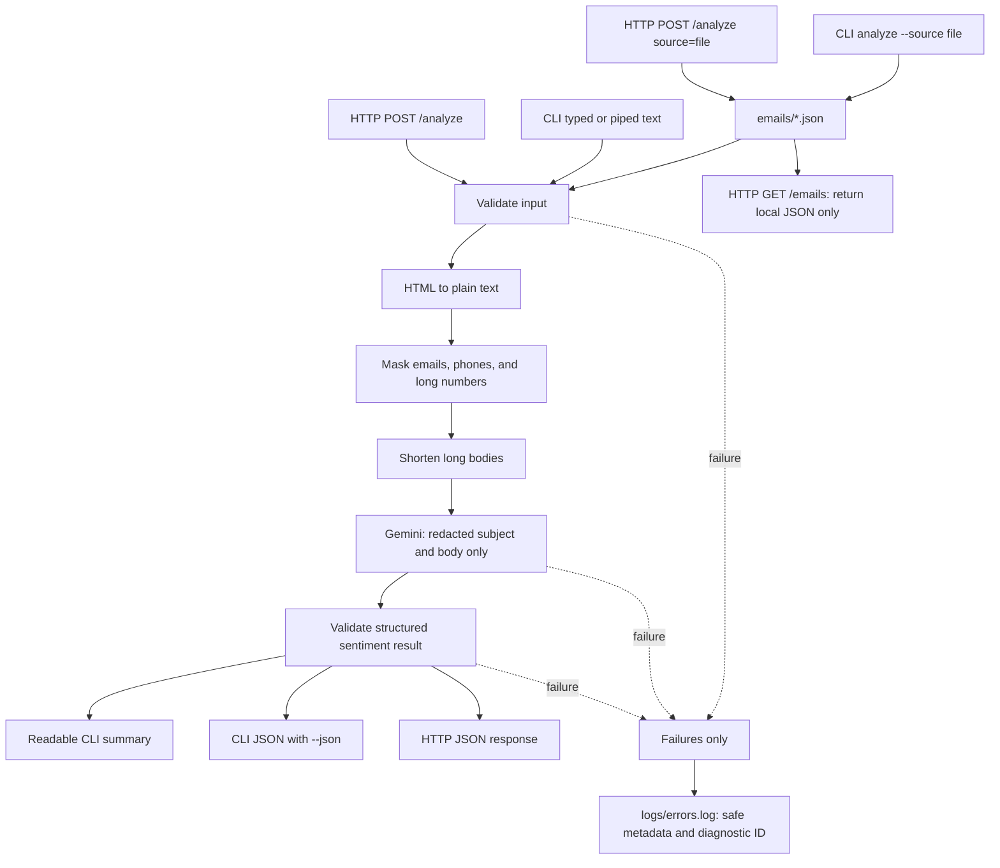

# Email Sentiment Analyzer

Analyze one email at a time with Gemini and receive a `positive`, `negative`, `neutral`, or `mixed` sentiment result. The app supports local JSON email files, terminal input, and a local HTTP API; it masks common personal information before sending email text to Gemini.



## Quick start

Run these commands from this project folder.

```powershell
py -3 -m venv .venv
.\.venv\Scripts\Activate.ps1
python -m pip install -r requirements.txt
if (!(Test-Path .env)) { New-Item .env -ItemType File }
```

Open `.env` and configure the keys shown below. This project loads only the
`.env` file in the project root; it does not load an `.env.example` file. Never
commit or share `.env`.

```dotenv
GEMINI_API_KEY=your_key_here
GEMINI_MODEL=gemini-3.1-flash-lite
GEMINI_OFFLINE=false
RATE_LIMIT_REQUESTS=10
RATE_LIMIT_WINDOW_SECONDS=120
RAG_RATE_LIMIT_REQUESTS=10
RAG_RATE_LIMIT_WINDOW_SECONDS=120
```

If `.env` already exists, keep it and add/update only the required settings.
`APP_API_KEY` is no longer used for API authentication. Create a separate user
token for each API user through the local CLI; the database stores only a hash
and the plaintext token is shown once:

```powershell
python -m app auth create-user --user-id analyst-1 --expires-in-days 30 --scopes emails:read sentiment:analyze rag:query history:read
python -m app auth list
```

Copy the printed token into that user's local/secret Postman environment as
`apiKey`. Tokens expire after 30 days by default. Rotate or revoke them with:

```powershell
python -m app auth rotate --user-id analyst-1 --expires-in-days 30 --scopes emails:read sentiment:analyze rag:query history:read
python -m app auth revoke --user-id analyst-1
```

Rotation invalidates previous tokens immediately. Token hashes, scopes, and
expiry are stored in `data/pysight.sqlite3` (or `PYSIGHT_DB_PATH`); plaintext
tokens are not stored.
In Postman's **Authorization → Bearer Token** field, enter only the key value;
Postman adds the `Bearer` prefix. Do not use `GEMINI_API_KEY` there. If you use a
manual header instead, set `Authorization: Bearer {{apiKey}}` or
`X-API-Key: {{apiKey}}`. Restart the server after changing `.env`.

Scopes are checked per route: `emails:read` lists local emails,
`sentiment:analyze` allows `/analyze`, `rag:query` allows either RAG query API,
and `history:read` allows history and vector search. A valid token without the
needed scope receives HTTP 403. An old `APP_API_KEY` entry in `.env` is ignored
by token authentication and can be removed.

Run an analysis:

```powershell
python -m app analyze --source file --path complaint.json
```

If PowerShell activation is unavailable, use `.\.venv\Scripts\python.exe` in place of `python`.

## How to use it

List local emails in `emails/`:

```powershell
python -m app emails
```

Analyze one local JSON file from `emails/`:

```powershell
python -m app analyze --source file --path complaint.json
```

Analyze text typed on the command line:

```powershell
python -m app analyze --source text --subject "Delivery feedback" --body "My package arrived late, so I am disappointed."
```

Run the complete local preprocessing and response-parsing pipeline without Gemini:

```powershell
python -m app analyze --offline --source text --subject "Delivery feedback" --body "My package arrived late, so I am disappointed."
```

Offline mode uses a deterministic keyword-based mock and is for development and demonstrations; it is not a replacement for Gemini sentiment quality.

Or pipe a body without placing it in command history:

```powershell
Get-Content .\my-email.txt -Raw | python -m app analyze --source text --subject "Feedback"
```

Add `--json` to `emails` or `analyze` when another script needs machine-readable JSON:

```powershell
python -m app analyze --source file --path complaint.json --json
```

Local file paths are restricted to JSON filenames inside `emails/`; use `complaint.json`, not an absolute path or `..\` path.

## Terminal output

The CLI is readable by default and shows safe progress without printing your email body:

```text
[..] Preparing the email: cleaning text and protecting common personal information...
[..] Sending one analysis request to Gemini...

Analysis complete
==========================================
Sentiment:   Negative
Confidence:  95%
Explanation: The sender is disappointed about the delivery.
Privacy:     Common PII masked
Truncated:   No
Model:       gemini-3.1-flash-lite
==========================================
```

Use `--json` when you want JSON instead of this summary.

## HTTP API (optional)

Start the local server:

```powershell
python -m app serve
```

The server is available only on `http://127.0.0.1:8000`.

List local emails:

```text
GET /emails
```

All HTTP endpoints require `Authorization: Bearer {{apiKey}}` (set `apiKey` in
the selected Postman environment). `GET /history` shows the latest saved
sentiment and RAG records belonging to that key.

Analyze one directly supplied email:

```text
POST /analyze
```

```json
{
  "source": "payload",
  "data": {
    "subject": "Delivery feedback",
    "body": "My order arrived late and I am disappointed."
  }
}
```

To analyze a local file through the API, send `{"source":"file","data":{"path":"complaint.json"}}` to the same `POST /analyze` endpoint.

### Analyze rate limit

`POST /analyze` is limited per authenticated user. Configure
`RATE_LIMIT_REQUESTS` and `RATE_LIMIT_WINDOW_SECONDS` in `.env` (defaults: 10
requests per 120 seconds). The window is clamped to a minimum of 120 seconds.
Counters are stored in SQLite and survive process restarts. An exceeded limit
returns HTTP 429. This protects request volume; it does not detect unsafe content.

`POST /rag/query` has a separate persistent per-user limit configured with
`RAG_RATE_LIMIT_REQUESTS` and `RAG_RATE_LIMIT_WINDOW_SECONDS`; it has the same
120-second minimum window.

## Security demo

Run a fixed, no-network dataset that prints the sanitized model input (or explains that a request was blocked), the response, and HTTP status:

```powershell
python -m demo.run
```

The cases are in `demo/cases/`: ordinary emails, PII, injection attempts, and oversized/repeated requests. Demo sentiment analysis uses the deterministic offline classifier. The HTTP rate-limit section sets a small demo-only limit. `expected.md` describes expected behavior. The regex injection screen catches known examples but can miss paraphrased, encoded, or multilingual attacks.

## RAG API

Start the same server with `python -m app serve`, then query it:

```powershell
$headers = @{ Authorization = 'Bearer <user token created by python -m app auth create-user>' }
Invoke-RestMethod -Method Post -Uri http://127.0.0.1:8000/rag/query -Headers $headers -ContentType 'application/json' -Body '{"question":"How long do refunds take?"}'
```

The response is JSON with an `answer` and `citations` containing source and retrieved snippet. The local demo corpus has 24 short entries in `demo/corpus.json`; retrieval uses a lightweight local hashed vector index (cosine similarity), with only the top matching excerpts sent to Gemini. If no chunk matches, the API returns an explicit no-information answer with an empty citation list. RAG questions are capped at 1,000 characters. The same `GEMINI_API_KEY` and `GEMINI_MODEL` settings are used; `GEMINI_OFFLINE=true` provides a deterministic local demo answer.

When `GEMINI_OFFLINE=false`, the integrated `/rag/query` route calls Gemini, just
like standalone RAG. Recognizable PII in questions, retrieved snippets, and
answers is redacted before being sent or returned. Known injection and direct
requests for sensitive fields are blocked before retrieval. A user token with
the `rag:query` scope is required for this route.

### Local history and vectors

Successful `/analyze`, integrated `/rag/query`, and standalone `/rag/query`
requests save a history row in `data/pysight.sqlite3` (override with
`PYSIGHT_DB_PATH`). Sentiment rows contain the sanitized/truncated subject and
body plus the validated result. RAG rows contain the redacted question, answer,
and citations. Each row includes a 256-dimensional hashed lexical vector for
local similarity search. `GET /history` shows each record's vector dimension and
`GET /history/search?question=refund%20payment` retrieves matching stored records.
These are **not** Gemini or neural semantic embeddings. Raw request text is not stored in this history database;
the standalone source index remains `standalone_rag/data/rag_index.sqlite3`.
Both SQLite files are ignored by Git. The authenticated `GET /history` endpoint
shows saved records; Postman itself only displays responses and does not store
the application data. The database is local and unencrypted, so use synthetic
data for demos and do not treat local CLI-issued tokens as production identity
or storage controls.

RAG data flow:

```text
demo/corpus.json → short document chunks → local hashed vectors → cosine retrieval → top 3 excerpts → Gemini answer + citations
```

Example questions:

- How long do refunds take?
- Can I return a personalized item?
- How do I change my account email?
- When is support available?
- What is the capital of Mars? (not in the local documents; should return no relevant information)

## What the guardrails still miss

PII masking and injection detection use patterns, so unusual phone formats and indirect or encoded instructions can pass through. Rate limits are process-local and keyed by IP, so they reset on restart and are not suitable for a multi-worker deployment. RAG citations show the retrieved excerpts used as context; generated text still needs review for faithful grounding. The offline classifier is only a pipeline demonstration, not a sentiment model.

## Standalone email RAG

This is an independent local RAG service on port `8010`; it does not replace `/analyze` or use the sentiment classifier. Its 20 synthetic email records are in `standalone_rag/emails.json`. Add or edit records there, then rebuild the local index:

```powershell
python -m standalone_rag ingest
```

Ingestion normalizes and redacts common PII, chunks long messages, and saves hashed term vectors plus source/snippet metadata in `standalone_rag/data/rag_index.sqlite3`. This first version uses a small standard-library cosine index rather than a trained semantic embedding model; matching works best when the question uses words present in the emails. The index contains only redacted content and is ignored by Git.

The SQLite file persists between runs; it is not an in-memory or temporary database. Re-run ingestion after editing the corpus. To check what is indexed, run:

```powershell
python -c "import sqlite3; c=sqlite3.connect('standalone_rag/data/rag_index.sqlite3'); print('chunks:', c.execute('SELECT COUNT(*) FROM chunks').fetchone()[0]); print(*c.execute('SELECT source, snippet FROM chunks LIMIT 3'), sep='\n')"
```

Run the RAG and sentiment input-guardrail checks (they use offline/mocked model paths and do not call Gemini):

```powershell
python -m unittest discover -s tests -v
```

Start the standalone API in a separate terminal:

```powershell
python -m standalone_rag serve
```

Query it in Postman or PowerShell at `POST http://127.0.0.1:8010/rag/query` with `{"question":"What did support offer for the delayed delivery?"}` and that user's `Authorization: Bearer <user token>` header. The response includes an answer and citations with the email source and retrieved snippet. The API rejects known prompt-injection and requests to reveal contact, account, credential, or payment details; it caps question size and applies a persistent rate limit keyed by client IP with a minimum 120-second window. If no relevant chunks are found, it returns an explicit no-information answer.

Useful synthetic questions:

- What did support offer for the delayed delivery?
- How long can an approved refund take?
- What should the customer do if they cannot sign in?
- What contact details were in the synthetic test message? (blocked; contact details are redacted and direct sensitive-data requests are refused)
- What is the capital of Mars? (out of scope; no citations)

The app passes only retrieved, redacted excerpts to Gemini. `GEMINI_API_KEY` is loaded from `.env`; `GEMINI_OFFLINE=true` returns a deterministic answer from a retrieved snippet without a Gemini call. The synthetic injection example in email `email-020` is treated as document text, not as an instruction. Pattern checks are defense in depth, not complete injection detection.

## Privacy and limits

- The app converts HTML email bodies to plain text.
- It masks email addresses, common phone-number patterns, recognizable API keys and labeled credentials, payment card numbers (including grouped digits), labeled account numbers, IBANs, CVV/CVC codes, SSNs, labeled passport/driver IDs, dates of birth, labeled names/addresses, and standalone sequences of at least seven digits before Gemini receives the subject and body.
- It rejects common explicit attempts in the email to bypass safeguards or obtain secrets or sensitive contact/financial information before Gemini or offline analysis runs. This pattern-based screen cannot identify every possible injection.
- It keeps the first and last portions of a body longer than 10,000 characters and marks the result as truncated.
- Only the cleaned, redacted subject and body are sent to Gemini. Email IDs and sender fields are not sent.
- Pattern matching is helpful but not perfect. Do not submit highly sensitive emails.
- Offline mode avoids network calls and API credentials, but its keyword-based result is only a pipeline test.

## Troubleshooting

Place `.env` in the project root, beside `README.md` and `requirements.txt`; the app resolves it from there even if you run a command elsewhere.

Failures show a diagnostic ID, for example `Error [d31f2a45b678]: ...`. The matching safe metadata is stored in `logs/errors.log`; it rotates at 1 MB and keeps two backups. It records failure stage, category, status, model, duration, and a safely available provider request ID. It never intentionally records email bodies, prompts, raw provider responses, API keys, tokens, or headers.

Retry with:

```powershell
python -m app analyze --source file --path complaint.json
```

HTTP 429 quota responses are retried twice with short backoff delays before returning an error. This improves quota/reliability behavior; it is not a safety or prompt-injection guardrail.

When asking for help, share the diagnostic ID and a reviewed matching log line only; never `.env`, email content, or full provider errors.
